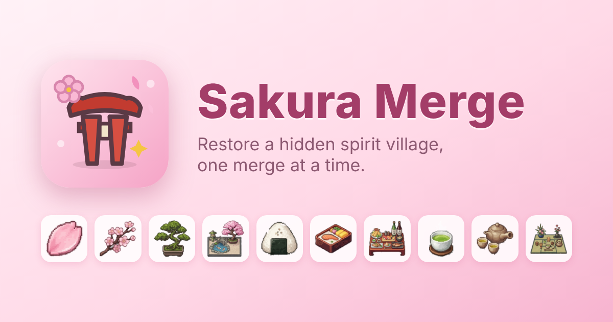

# Sakura Merge

A cozy merge game: step through a hidden torii gate and restore a forgotten spirit
village by merging sakura, food and tea treasures.

**Play:** https://mzhang008.github.io/mergegame/ — free, no ads, no account, works offline.
On a phone, use *Add to Home Screen* to install it like an app.



## The game

- **Merge**: drag two identical items together to make the next tier. Three chains of
  seven tiers each: Sakura (petal to spirit garden), Food (chopsticks to grand banquet)
  and Tea (leaf to tea ceremony room).
- **Generators** at the bottom make tier-1 items for 1 energy. Energy refills at 1 point
  every 20 seconds (a full bar in 40 minutes), including while the game is closed.
- **Quests** pay coins and XP for delivering a specific item. You can swap a quest for free.
- **Restore the village** in five steps by placing the items each step shows and paying
  coins. Hana, the shrine's apprentice miko, tells the story as the village heals.
- **Spirit Album**: forge each chain's final item to collect its sticker.
- **Daily blessing**: a 7-day streak of coins and energy for coming back each day.
- **Hanami Festival**: merges of tier 3 and up earn petals for village decorations.
- **Selling**: drag an item onto the bar that appears at the bottom to sell it, with Undo.

Progress is saved in the browser on your device. Levels 5 and 10 add a row to the board.

## Development

The game is plain HTML, CSS and JavaScript with no build step. Everything that ships
lives in [`game/`](game/).

```sh
npm start          # serves game/ at http://localhost:8765
npm ci             # install the test runner (Node 18+)
npm test           # 41 end-to-end tests in Chromium
npm run test:webkit  # same tests in WebKit (Safari's engine); run `npx playwright install webkit` first
```

### Project layout

| Path | What it is |
| --- | --- |
| `game/` | The shipped game: `index.html`, `game.js`, `style.css`, `sw.js` (offline support), art, icons, privacy and credits pages |
| `tests/` | Playwright end-to-end tests |
| `tools/serve.js` | Zero-dependency static server for local play and tests |
| `tools/slice_sheet.py` | Cuts the item icons out of the art sheet (see below) |
| `art-source/` | Source art (the item sheet) |
| `economy/` | Economy simulator used to tune pacing |
| `GDD.md` | Game design document |

### Deploying

Every push to `main` or `claude/upbeat-tesla-g9Hci` runs the test suite in GitHub
Actions and, if it passes, deploys `game/` to GitHub Pages (repository *Settings ›
Pages › Source* must be *GitHub Actions*). Pull requests run the tests without deploying.
A WebKit run reports alongside but does not block a deploy.

### Releasing a new version

1. Update `CONFIG.version` in `game/game.js` and `VERSION` in `game/sw.js` (the service
   worker uses it to drop old caches).
2. If you add or remove files in `game/`, update `PRECACHE` in `game/sw.js`; a test fails
   if the list and the folder disagree.
3. If the save format changes, bump `CONFIG.storageVersion` and make `loadState()` read
   older saves. Older saves load through defaults, so additive changes need nothing more.
4. Add an entry to [`CHANGELOG.md`](CHANGELOG.md).

### Turning on analytics

The game can count anonymous events (sessions, tutorial completion, restoration steps,
day-1/3/7/14/30 returns and similar) with [GoatCounter](https://www.goatcounter.com).
It is off in this repository.

1. Create a GoatCounter site, for example `sakuramerge` for
   `https://sakuramerge.goatcounter.com`. Check GoatCounter's current terms for your use.
2. Set `ANALYTICS.goatcounterCode` near the top of the analytics section in `game/game.js`.
3. Deploy. A *Share anonymous usage stats* switch appears in Settings.

Nothing is sent when that switch is off, when the browser sends Do Not Track or Global
Privacy Control, or on localhost. Events go straight to GoatCounter's `/count` endpoint;
no third-party script is loaded. Review [`game/privacy.html`](game/privacy.html) before
enabling.

### Item art pipeline

The 21 item icons come from `art-source/items-sheet.webp`, a 3×7 sheet whose
checkerboard background is painted into the pixels. `tools/slice_sheet.py` removes it and
writes square palette PNGs:

```sh
python3 -m venv .venv && .venv/bin/pip install pillow numpy
.venv/bin/python tools/slice_sheet.py art-source/items-sheet.webp out/ 160
```

The script's docstring explains the row-to-chain mapping (the food row swaps sheet
columns 5 and 6) and how to install the output into `game/art/items/`.

## Credits

Item, village, character and icon art was made for Sakura Merge. Interface emoji are
[Twemoji](https://github.com/jdecked/twemoji) graphics (CC BY 4.0), with the Twemoji parser
under the MIT License; see [`game/credits.html`](game/credits.html).
